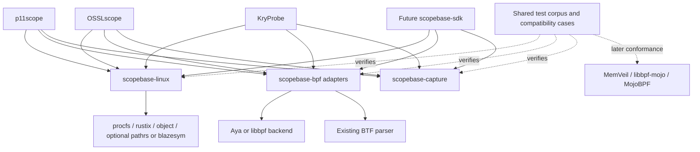

# Shared observer libraries: feasibility and proposed extraction roadmap

Date: 2026-10-17. Status: research and architectural proposal for review; not an approved implementation specification. No product source was changed, and no product builds or runtime tests were run for this study.

The subsequent [ScopeBase specification](../../superpowers/specs/2026-10-17-scopebase-design.md) and [complete plan](../../superpowers/plans/2026-10-17-scopebase.md) now define the project. Following the owner's instruction, package qualification uses real independent reference applications; donor migrations and duplicate retirement happen later under MG01–MG05. All filesystem/user-conformance obligations remain required for the advertised package profiles.

## Recommendation

**Proceed with a small family of independent Rust libraries and a shared regression corpus. Use p11scope and OSSLscope as the initial design donors, with real independent reference consumers before later product migration.** Add a small application framework after those libraries work in those consumers. Keep C/Mojo interoperability as the third priority, building on libbpf-mojo and MojoBPF's existing direction.

The opportunity is substantial, and the overlap is much broader than multi-uprobes. Process/image identity, descriptor ownership, discovery budgets, ELF offsets, attachment retirement, loss accounting, measurement windows, BTF validation, compiler regressions, and test infrastructure recur. Some implementations are already shared by ancestry or explicit borrowing. Others solve superficially similar problems with different guarantees. The goal should be to retire duplicated bug-prone mechanisms while retaining those guarantees.

Do not maximize moved lines or crate count. Maximize the number of independently useful contracts whose difficult regression cases now have one maintained implementation or one common conformance suite. Sharing an unresolved assumption could propagate a bug to every consumer.

## Agreed scope and priorities

The owner requested: (1) independent Rust crates, reusable tests and documents; (2) a framework making future scope applications easier; (3) language-neutral reuse later. All branches/worktrees and relevant uncommitted source/docs count as evidence. Missing necessary work must be recorded in a TODO. OSSLscope/p11scope common kernel and compiler experience deserves particular attention. MojoBPF is a future integration consideration, not a request to migrate the Mojo projects now.

The owner additionally requires a ready package to include filesystem/mapping checks that library users can run themselves, while maintainers fully test its advertised behavior. Explicit calibration means an explicit invocation/effects policy; it does not make that behavior's implementation, regression suite or documentation optional. The small held-file pilot remains an internal development increment. It does not by itself satisfy the requested ready mapped-image package.

This study inventories all locally visible branch and remote-tracking refs and registered worktrees in the four main workspaces, with a bounded MojoBPF reconnaissance. It groups ancestors and patch-equivalent history, investigates divergent fixes and relevant WIP, and records exact source pins in the repository notes. It is not a line-by-line audit of every historical commit, and remote-tracking refs are not a fresh assertion about remote publication. Generated binaries/logs and unrelated private transcripts are excluded from source review.

## Reading map

| Document | Purpose |
|---|---|
| [Overlap matrix](overlap-matrix.md) | What overlaps, implementation/test-source status, missing or uncertain coverage, donor-to-recipient opportunities. |
| [Testing strategy](testing-strategy.md) | Six evidence tiers and 32 concrete regression scenarios; independent oracles, mutation controls and compatibility gates. |
| [Testing delivery plan](testing-delivery-plan.md), [regression catalog](regression-catalog.json) | Issue-to-test-to-consumer workflow, finite environment cells, runner sensitivity, affected-check selection and 32 planned case families. |
| [TODO](TODO.md) | Dependency-aware work to create or evaluate; explicit gaps and exit criteria. |
| [Existing-library comparison](external-comparison.md) | Adopt, wrap, upstream or extract decisions; primary-source research and alternatives. |
| [Kernel/toolchain investigations](kernel-toolchain-notes.md) | The remembered instruction/kernel issues, exact source/history matches, and reusable regression obligations. |
| [User-run conformance](user-conformance.md), [test distribution](test-distribution-options.md) | How library developers and operators run shipped checks on the actual implementation, with controlled fixtures and explicit environment limits. |
| [Deep gap analysis](gap-analysis.md), [conformance architecture review](conformance-architecture-review.md) | Additional missing API/package/runtime obligations and the conditions for a ready mapped-image package. |
| [p11scope](p11scope.md), [KryProbe](kryprobe.md), [OSSLscope](osslscope.md), [MemVeil/MojoBPF](memveil.md) | Detailed donor files, symbols, fixes, tests, source pins, WIP, branch/worktree inventory and limitations. |
| [Architecture review](architecture-review.md), [synthesis review](synthesis-review.md), [document checks](document-checks.md), [final verification](final-verification.md) | Independent Astra, Sol and Luna reviews and final research-artifact checks, with runtime qualification limits. |

## Findings that matter most

1. **p11scope and OSSLscope are the natural first pair.** Both inspect running processes and mapped libraries, resolve file offsets, hold attachments through lifecycle changes, and translate incomplete observations into reports. p11scope's `bpf-multi` explicitly references OSSLscope's UAPI/bisection work. That makes shared Linux identity/image handling and attachment policy more compelling than inventing a generic framework first. See p11 candidates 1, 4, 5, 7 and OSSL candidates O1, O3–O6, O9.
2. **The hardest fixes belong with their negative tests.** Examples include Btrfs/overlay device-domain mismatch; descriptor-bound attachment surviving A→B→A pathname replacement; local `.maps` relocations selecting distinct FDs; real ring cursor wrapping/read-only mappings; per-CPU buffers sized by possible CPUs; insertion-time identity surviving CPU migration; and a diagnostic channel that still works when the map it diagnoses is full. Existing source tests establish useful starting points, not a fresh pass for extracted code.
3. **A common completion boolean would be wrong.** KryProbe's fence has architecture/probe assumptions. p11scope couples admission, writer accounting, retained owners and bounded drain. OSSLscope has an explicit countermodel where an admitted hit completes after the last drain and is invisible. MemVeil has a stop model but open live settlement wiring. Share evidence/result vocabulary and protocol tests before attempting a shared live shutdown engine.
4. **Some valuable work is outside main or not committed.** The notes include p11scope's active H8/H9 changes and stage3 experiments, KryProbe's active selftest lane and workspace validators, OSSLscope's preview and workspace-only harness branches, and newer libbpf-mojo/MojoBPF worktrees. WIP can supply requirements and future tests; it should not silently become the stable extraction baseline.
5. **Dependencies should remove code, not add a second stack.** Aya/libbpf cover loading; object/goblin cover ELF; procfs already pins proc directories; rustix/nix cover descriptors/syscalls; libpathrs addresses confined lookup; blazesym provides normalization and Rust/C APIs; btf-rs is an especially relevant independently extracted BTF reader. The proposed libraries add the missing application contracts above these. See the [comparison](external-comparison.md).

## Three approaches

| Approach | Benefits | Costs and risk | Decision |
|---|---|---|---|
| Independent libraries + regression/compatibility corpus | Gradual adoption, useful outside BPF, failures local to one boundary, existing backends stay usable. | Requires deliberate interfaces and a second consumer; some product orchestration remains duplicated. | **Recommended now.** |
| One shared scope framework/runtime | Fast new applications once the contracts are stable; common diagnostics, lifecycle and output integration. | Prematurely couples different observation surfaces, live/batch semantics, support floors and release cycles. | Derive a thin SDK after at least two real integrations. |
| Language-neutral core with Rust/C/Mojo bindings | One implementation across languages where the same semantics are needed. | ABI ownership, allocation, diagnostics, concurrency and compiler support become additional contracts. Existing libbpf-mojo already owns part of this space. | Third phase, selective helpers or schemas first. |

## Suggested name and packaging

Recommend **Scopebase** as the umbrella name: reusable foundations for scope applications, with Linux helpers also useful to profilers, debuggers, process scanners and test runners. The current `bpfscope` directory can remain the research workspace; no rename is needed now.

`scopekit` already exists on crates.io. The registry returned HTTP 404 for `scopebase` and the proposed family on 2026-10-17; see [name-check.json](name-check.json). This is an availability observation, not a reservation or a trademark assessment.

Start in one source repository with independently usable Cargo packages. Begin with modules and split a package only when its dependencies, consumers or versioning justify it. Candidate names are proposals, not packages created by this study:

| Proposed package | Contract and first consumers | Keep outside |
|---|---|---|
| `scopebase-linux` | Process authority, retained proc/file handles, mapped-image identity domains, bounded reads and helper budgets. p11scope + OSSLscope first; KryProbe helper code next. | BPF dependency, crypto discovery, automatic global signal handlers, arbitrary killing, hidden process-wide registries. Start with identity/image modules; a helper supervisor can follow after its process-global constraints are resolved. |
| `scopebase-capture` | Small pure Rust types/functions for epochs, loss units/provenance, count bounds, scoped completeness, immutable report views and checked terminal outcomes. OSSLscope + KryProbe first; p11scope adapters follow. | One universal session machine, product schemas, crypto policy, implicit live settlement or timestamp-nearness attribution. |
| `scopebase-bpf` | Checked map geometry, feature-result adapters, bounded attachment planning/rollback, cookie association and retained link ownership. Modules/features separate maps from uprobes. | A replacement ELF/BTF loader, compulsory libbpf and Aya dependencies together, a universal safe fence. Existing loader patches remain individually tracked. |
| `scopebase-testkit` | Shared scenario definitions, independent expected outcomes, fault injection, consumer conformance helpers, object checker utilities and small owned workloads. | Bulk evidence archives, production dependency on test frameworks, product-specific truth equations. Non-Rust fixtures/scripts can live alongside the crate. |
| `scopebase-btf` — conditional | Strict bounded semantic queries and capability/shape evidence over an existing BTF parser, if two consumers need a separate package. | A new parser by default; per-product crypto/DMA hook profiles. Fold into `scopebase-bpf::btf` if an adapter is small. |
| `scopebase-sdk` — later | Composes proven libraries into a small example application and reusable setup/diagnostic patterns. | Mandatory daemon, Kubernetes, plugin system, universal output schema or runtime framework before demand exists. |

Build helpers and kernel/compiler regressions initially belong in `tools/` and the testkit. A separate build-support crate is justified only if multiple independent consumers need its API; avoid forcing the BPF nightly toolchain on a host-only Rust library.

The first `scopebase-linux` slice should be smaller than the eventual package: acquire a regular held file, read within explicit limits, and return retained bytes plus separately typed descriptor/stat evidence. Use OSSLscope's `PinnedFile`/`read_bounded_from` and p11scope's manifest `open_regular`/`inspect_file_with_reader` as file-level donors. Keep ELF parsing and product discovery policy with the consumers initially. Neither FD retention nor length/mtime checks prove immutable file contents. Any maps-domain calibration is an optional operation with a no-new-mapping mode and an inconclusive outcome. An attachment adapter must own the file capability until detach or explicit unresolved quarantine; this ownership direction must not introduce a BPF dependency into the Linux crate.

Arrows indicate dependency direction, not a requirement to select every named alternative. Pure capture types and host Linux utilities must remain usable without loading BPF or depending on the application crates. MemVeil's reducers and MojoBPF's compiler remain independent.

## Identity is several contracts

Treat these as different types/evidence, not interchangeable integer keys:

- **Process observation vs control authority:** a retained proc directory permits reads; a pidfd can supply process-specific control. Acquiring both consistently is a separate check. PID/starttime alone does not define every operation's authority.
- **Birth vs execution:** an exec can preserve PID and process starttime while replacing the address space. p11scope's producer task cookie/exec ID and OSSLscope's proc/lifecycle evidence have different strengths; an adapter must state what it can prove.
- **File, mount and mapped image:** fstat device/inode, maps-rendered device, mount namespace/mount ID, held content and address-space generation need named domains. FD pinning prevents pathname replacement from retargeting the descriptor; it does not prevent in-place mutation.
- **BTF identity:** numeric type IDs are local to their BTF/base-module context. BTF availability and field-name matches do not establish compatible prototypes, layout, hook behavior or support.
- **Observer restart:** new observer epochs must not reuse stale cookies or merge prior partial windows. Restart-and-rescan can be designed first. Crash-resume of pinned BPF state is a distinct, later feature requiring reconciliation, not an accidental consequence of sharing a library.

For an API sketch, prefer owning `ProcessHandle`/`PinnedImage` values and tagged identity evidence over `(pid, path)` calls. Return a refusal or degraded observation with its reason when evidence is insufficient. Exact names/fields require the first component's written design; this study does not freeze a universal key format.

## Kernel and compiler compatibility

Support needs multiple independent decisions: instruction subset; compiler/linker lowering; loader/relocation support; kernel configuration/helpers/maps/hooks; target BTF shape and semantic profile; attach behavior; workload correctness; performance. A kernel release number is an eligibility hint, not the whole decision.

Use one common capability vocabulary with application-owned requirements. Keep `supported`, `unsupported`, `denied`, `unknown`, and `incompatible` distinct, and record whether the conclusion comes from metadata, a load probe, actual attachment or a behavior probe. Privileged probes should be explicit operations with owned resources.

Older support must be selective. BTFHub can supply matching type metadata but cannot supply a missing helper or reproduce ring-buffer ordering on a perf-buffer fallback. A fallback that weakens observation must expose that fact. There is no evidence here that every product can or should share one old-kernel floor: KryProbe aggregate/lifecycle modes and MemVeil's confidential transitions have different requirements.

New kernels also need tests. p11scope's recorded private-stack/preemption failure, behaviorally different distro uretprobe/seccomp kernels, and changed exec-field shapes demonstrate why a newer release is not automatically a stronger support claim. Preserve the narrow trigger, affected object/probe, workaround, test, and removal criterion for each issue. The [kernel/toolchain note](kernel-toolchain-notes.md) distinguishes instruction generation, verifier limits, loader defects and JIT behavior.

The remembered investigation was found: LLVM's `v4` preset grew to include additional instructions, so the same CPU name across compiler versions does not imply the same kernel requirements. The separate used-result atomic RMW defect could update memory correctly yet return the wrong old value. Its [upstream fix, LLVM PR 210371](https://github.com/llvm/llvm-project/pull/210371), merged on 2026-10-13; selected Rust/linker binaries still need inclusion and semantic checks. AtomicLoad selection and mixed-language linker/BTF failures are separate issues. H29–H32 preserve these distinctions, including actual final objects and independently expected results.

## What should remain in the applications

PKCS#11 object/session/handle semantics and privacy policy stay in p11scope; OpenSSL provider dispatch, alias/FIPS/algorithm interpretation stay in OSSLscope; kernel-crypto request/transform lifecycle stays in KryProbe; DMA/confidential-memory state and correlation stay in MemVeil. The initial library must not force all of them into a crypto-specific event schema.

Keep verifier-sensitive BPF control flow local until a shared implementation survives emitted-object and real-kernel tests. Moving code across crate boundaries can change inlining, stack use, relocation and verification even when host tests remain green. Similarly, KryProbe's deliberately different batch/live drivers should consume common contracts without being merged.

Per-file SPDX metadata differs across host Rust, BPF programs, ABI twins and native bridges. Preserve provenance and settle intended library licensing before moving code. This research reports metadata, not a relicensing permission. Public documentation should be rewritten from the reusable technical lesson, without private workspace paths or operational history.

## Proposed sequence and exit criteria

| Phase | Deliverable / dependency | Concrete exit criterion |
|---|---|---|
| **0. Select and preserve the regression contracts** | Choose narrow donor pins from the inventories, reconcile applicable WIP, select first library boundary and license/MSRV policy. Create issue-to-test entries. | Each selected case has trigger, invariant, independent expected outcome, donor source/test, support limits and extraction owner. No unresolved WIP silently promoted. |
| **1a. Internal Rust pilot** | `scopebase-linux` held-file acquisition and bounded-read slice over selected existing dependencies; two independent real reference adapters. | Both reference clients use the public selected mechanism through distributed builds; applicable file/FD-budget cases pass. Product migration/duplicate retirement remain later MG work. This increment does not yet complete the requested ready mapped-image package. |
| **1b. Ready mapped-image capability** | Explicit maps-domain proof/calibration API, runtime validity rules, shipped user conformance API/runner/fixtures and documented support profiles. | Advertised Btrfs/overlay/namespace behavior has real maintained fixture cells, independent oracles and user-run paths. Calibration and no-new-mapping modes both have tests. Missing required cells remain incomplete; users receive diagnostics/refusals with effects and limits. Process supervision remains a separate follow-on. |
| **2. BPF primitives and upstream work** | Map geometry and attach planning, shared patch/regression manifest, BTF adapter trial. Can proceed beside phase 1 with disjoint files. | Consumer ABI and actual object tests pass; capability/failure behavior is preserved; affected live cases pass on the selected cells. Upstream replacement removes a patch only after its regression passes. |
| **3. Capture semantics** | Small capture-quality/provenance primitives after agreeing units and scope; retain backend closure protocols. | Independent traces give equivalent valid results in two consumers; late/unknown/loss/counter-reset cases cannot manufacture completeness; product-specific reports remain faithful. |
| **4. New-application SDK** | Compose stable slices from phases 1–3. Add host and selected live non-crypto observer applications using independent workloads. | Standalone applications reuse qualified public mechanisms, report capability/loss honestly, and pass applicable conformance. Product migration is not a prerequisite. |
| **5. Selective cross-language reuse** | Audit libbpf-mojo's actual consumed vs newer branches and MojoBPF's ELF/BTF direction. | At least two real language consumers agree on independently authored vectors; ownership/ABI/diagnostic behavior is tested. No language migration is required. |

The first development increment should be intentionally small: retained file capability + bounded reads, with process observation authority included only where acquisition needs it. Design the maps-domain/user-conformance increment explicitly and include it in the ready mapped-image milestone. Process lifecycle transports and finalization protocols need separate designs. Compiler regression and artifact-manifest work starts alongside this work. The phase numbers describe dependency order, not an estimate of elapsed weeks.

Every extracted component moves as a unit: code, contract documentation, failure explanation, regression fixture/oracle, consumer migration, and a way to retire the old copy. Keep application release work and active H8/H9/successor fixes moving independently. One writer per shared package; serialize shared kernel/VM resources. A local library regression need not trigger every product test, but changes to emitted BPF, ABI or lifecycle semantics must trigger their affected integration cells.

## Good testing is part of the library

The [test plan](testing-strategy.md) is a deliverable, not an optional appendix. Pure Rust/property/model tests cover bounded logic; actual-object tests cover compiler/loader contracts; Linux process/filesystem tests cover descriptor and lifecycle behavior; isolated live tests cover the real BPF/kernel boundary. Cross-consumer tests detect a generalization that only works for its original donor. Later cross-language tests use independently expected bytes/results, not round-tripping one implementation into itself.

Require a nonempty independent positive population and negative controls. A zero-match test, skip, timeout, successful attach or old green CI cannot certify the new library. Use mutation tests on the particular oracles that historically accepted broken behavior. Test memory/FD/queue bounds and cancellation, not only counts. Preserve a documented counterexample when a guarantee is unavailable rather than inventing a stronger API.

The [delivery workflow](testing-delivery-plan.md) connects each issue to a minimal reproducer, independent expected outcome, known-bad control, repaired implementation, affected consumer checks, installed package and duplicate/workaround retirement. The [initial catalog](regression-catalog.json) supplies these planned relationships for H01–H32. It deliberately records no runnable implementation or passing result; exact selected pins, subcases, adapters and environment manifests must be resolved during porting. Its cases supplement UC01–UC14 and G01–G23 rather than replacing them.

## Tests delivered to library users

Ship three connected surfaces: a source-packaged regression corpus, an embeddable conformance API used through the consumer's actual library adapter, and a runnable operator route (standalone tool or application command). Merely depending on a crate does not run its tests; see the [Cargo distribution constraints](test-distribution-options.md). Record the selected package/version/features/backend, fixture and environment with each result. A separate diagnostic binary may test a different library build, so it cannot silently certify the application's embedded copy.

Separate runtime evidence from test reports. Runtime mapping evidence must be bound to the held object and relevant process/mount context, with explicit revalidation/invalidation rules. A passing local test report is a result for a named scenario and environment; it is never a reusable authorization token for arbitrary mappings. Probe modes must declare whether they create mappings, files, processes, mounts or BPF attachments. No-new-mapping mode needs a real noninterference test, not only a mocked permission flag.

Build the required test set from the advertised support profile before discovering the environment. A missing Btrfs/overlay fixture or denied operation cannot silently remove its obligation and make the profile green. Maintainers run all required support cells; users can run available cases and receive explicit missing/blocked coverage. Here, fully tested means all required cases for a declared version/feature/environment contract have passed with independent expected results; it is not a promise about every possible kernel or filesystem configuration.

## Knowledge to retain outside crates

Maintain a small issue cookbook and regression index. Each record needs: failure layer; trigger; invariant; minimal source/fixture; affected and tested compiler/kernel/architecture; fix/workaround and original source commit; current upstream issue/status; required test tier; known limits; and a condition for removing the workaround. No large evidence archive is needed.

Examples to seed it: CPU-preset drift; used-result atomic lowering; AtomicLoad selector and mixed-language BTF retention; local map section/addend relocation; exported dead memory builtins; explicit padding for older verifiers; read-only mmap atomic lowering; ring cursor wrap/BUSY/discard; BTF DECL_TAG size; iterator mm lifetime capability; per-program writer partitioning; descriptor replacement and Btrfs/overlay domains; late completion after a bounded drain; unknown identity collision; transient snapshot partialness versus real accumulated loss. The TODO assigns the missing shared artifacts and tests.

## Current decision

The feasibility is strong for independent mechanisms and test infrastructure, moderate for common capture types, and conditional for a shared runtime or C ABI. The full ScopeBase specification now defines independent real reference consumers, detailed SDK/native deliverables and later product migrations. The small held-file/bounded-read increment and compiler-corpus workstream remain good starting points; the complete planned scope is broader.
