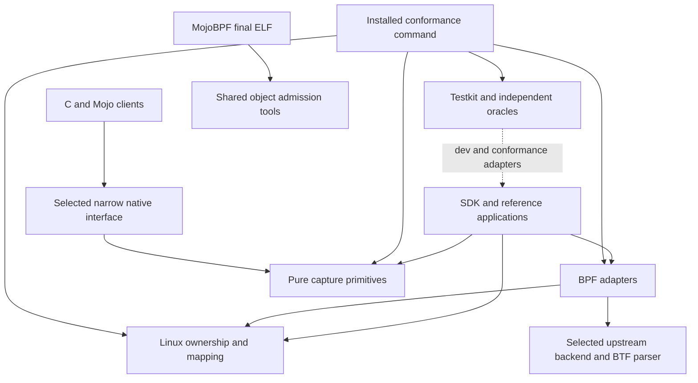

# ScopeBase project specification

Date: 2026-10-17. Status: complete design candidate for review and implementation planning. This document specifies future software; it does not report implemented or qualified packages. The user requested the complete specification and plan together. Product migration is explicitly later work.

## Intent and scope

ScopeBase preserves difficult Linux/BPF and observation-system fixes as independently useful libraries, reusable regression cases and explanatory documentation. It must reduce repeated repair work across p11scope, OSSLscope, KryProbe and MemVeil, and make new applications easier to build. MojoBPF is a future standard-object producer and conformance participant, not a compiler to replace.

The priorities, in order, are (1) reusable Rust mechanisms and tests/documents, (2) a small SDK and real new-application examples, and (3) selective C/Mojo interoperability. All three are in this specification and implementation program. Existing application migration and duplicate retirement are a fourth, separately scheduled integration milestone. Package qualification cannot depend on completing those migrations, and cannot imply that they happened.

Use **ScopeBase** in prose and `scopebase-*` for package names. The existing `bpfscope` directory stays in place. Availability observations in the research are not reservations; publication rechecks names. The [research](../../research/2026-10-17-shared-libraries/README.md) remains source evidence. This specification supersedes its migration-based readiness prerequisites, while preserving its technical and test obligations.

## Architecture decision

Choose independent libraries with shared conformance infrastructure. A single framework first would couple incompatible observation and shutdown semantics. A language-neutral runtime first would add ABI/compiler complexity before the reusable contracts are stable. The chosen family provides each useful boundary directly, then composes it in the SDK and exposes selected native interfaces.

| Package or area | Required responsibility | Dependency boundary |
|---|---|---|
| `scopebase-linux` | Held files, positional bounded reads, stat/maps/mount domains, explicit mapping evidence, process observation, optional owned-child supervision and budgets | No BPF toolchain, loader, capture reducer, async runtime or hidden signal installation |
| `scopebase-bpf` | Checked map operations/topology, bounded attachment policy, retained owners, transport and BTF queries | Optional selected backend adapters; existing Aya/libbpf/parser implementations own low-level loading/parsing |
| `scopebase-capture` | Units, epochs, provenance, checked arithmetic, independent facts, views, strict neutral replay and scoped closure descriptions | Pure `std` default; optional JSON; no kernel authority or common product reducer |
| `scopebase-testkit` | Case/profile contracts, independent vectors/oracles, consumer adapters, fixtures and verdict validation | Production packages never depend on it; tests/examples/operator tooling do |
| `scopebase-conformance` | Installed operator command and complete offline fixture delivery | Tests its own compiled implementation binding; cannot certify a different application's embedded copy |
| Toolchain/object tools | Producer manifests, opcode/ELF/BTF checks, regression builds, patch/workaround tracking | Explicit build operation; ordinary host builds never discover/install a BPF compiler |
| `scopebase-sdk` | Thin setup/policy/diagnostic/conformance composition and host/live sample applications | Backend-specific admission and shutdown remain explicit; no daemon or plugin runtime |
| Native corpus and selected `scopebase-ffi` | Versioned neutral vectors, C/Mojo clients, standard ELF/BTF admission and a narrow justified ABI | Reuse libbpf-mojo; do not build another generic BPF bridge |

`scopebase-btf` and a build-support crate are conditional packaging splits, not omitted work: BTF semantics and build helpers must be implemented in the named module/tool area first. A split needs a recorded dependency/versioning benefit and two concrete independent users. Do not create a universal `scopebase-core` crate solely to share enums.

The arrow from BPF to Linux is only for features requiring held-file/process authority. Geometry, pure planning and object tools must remain independently buildable. Testkit references above denote integration/test edges, not production dependency cycles.

## Normative project requirements

Each requirement has an owning task in the [master plan](../plans/2026-10-17-scopebase.md) and [traceability registry](../plans/2026-10-17-scopebase-traceability.json). Subsystem requirements add detail; they do not weaken these rules.

| ID | Requirement | Acceptance criterion |
|---|---|---|
| SB-R01 | Preserve all three priorities and later migrations as distinct deliverables. | Every research TODO, H, G, UC and overlap entry has an explicit task/disposition; SDK and native phases have executable tasks and completion gates. |
| SB-R02 | Select donor bytes with branch/worktree/WIP and per-file provenance. | Each copied/adapted mechanism names full source SHA, dirty-file hash where applicable, license, original defect and retained regression. Moving branches never substitute silently. |
| SB-R03 | Prefer an existing implementation plus a narrow tested adapter. | Dependency records compare the required donor failures, name the selected release/pin and retained gaps; alternatives are not all added as dependencies. |
| SB-R04 | Keep independently useful packages and additive features. | External minimal/default/supported-union clients compile without sibling paths; Linux/capture builds do not invoke BPF/native tooling. Unsupported feature combinations fail explicitly. |
| SB-R05 | Keep authority, observations, evidence and reports distinct. | Public constructors cannot deserialize live file/process/link authority; compile-fail and stale/foreign-object controls exercise the boundary. |
| SB-R06 | State typed operation errors and partial effects. | Callers can distinguish stage/reason/source error and cleanup disposition without parsing prose; retry tests cannot duplicate effects or lose owners. |
| SB-R07 | Declare byte/work/memory/wait and resource limits separately. | N/N+1, overflow, stalled inner syscall and repeated abandonment tests meet each advertised bound; a cooperative deadline is not labeled hard cancellation. |
| SB-R08 | Define ownership, concurrency, fork and fallible retirement. | Allowed Send/Sync/reentrancy and caller-fork behavior are documented/tested; successful data observation cannot erase failed cleanup or create unbounded quarantine. |
| SB-R09 | Preserve product semantics at adapter boundaries. | No generic completion boolean, unified loss counter, timestamp-based identity, or shared crypto/DMA reducer erases different guarantees. Independent counterexamples remain tests. |
| SB-R10 | Ship user-runnable conformance with each advertised capability. | Developer adapter and independently usable installed operator route execute applicable cases from the distributed package; exact bindings, limits and effects are visible. |
| SB-R11 | Qualify required profiles with independent truth and sensitive controls. | Required cases/cells are fixed before environment discovery; known-bad controls fail intended assertions; missing required activity/cells/cleanup cannot yield qualification. |
| SB-R12 | Maintain component-specific kernel/compiler compatibility. | Actual final objects and selected oldest/current/reproducer cells establish each claimed behavior; metadata, loading and semantics are separate evidence. |
| SB-R13 | Publish honest API, schema and support versions. | Rust semver, neutral schema, fixture/case and support-profile revisions are separately tested; unknown incompatible versions refuse explicitly. |
| SB-R14 | Keep diagnostics opt-in, bounded and appropriate for a library. | No implicit stdout/log upload or raw captured bytes; unusual paths, large messages and denied operations preserve structured results without corrupting framing. |
| SB-R15 | Qualify independent reference applications before stabilization. | Two materially different real public-path clients pass selected contracts through distributed builds; no mocked-only or two-wrapper substitute. Product migration remains unclaimed. |
| SB-R16 | Keep implementation parallelism safe and reviewable. | A dependency DAG, one owner per shared interface/file, isolated outputs and explicit guest/host leases prevent concurrent mutation; interface changes invalidate dependents. |
| SB-R17 | Preserve issue knowledge and upstream removal tests. | Each adopted hard fix has a minimized reproducer, explanation, support limits and workaround removal condition; merged upstream code is tested through the selected consumer build. |
| SB-R18 | Define completion at the appropriate level. | Specification, implementation, package-ready, SDK/native-ready and product-migrated states are reported separately, with exact open required gates. |

## Subsystem contracts

- [Linux specification](2026-10-17-scopebase-linux-design.md): acquisition/read/mapping/process and resource ownership.
- [BPF/toolchain specification](2026-10-17-scopebase-bpf-toolchain-design.md): backend contracts, BTF, ABI, object and compiler compatibility.
- [Capture specification](2026-10-17-scopebase-capture-design.md): provenance, units, evidence and reusable reduction primitives.
- [Testing specification](2026-10-17-scopebase-testing-design.md): distributed conformance, fixtures, required matrices, runner trust and results.
- [SDK/native specification](2026-10-17-scopebase-sdk-native-design.md): substantive priority-two and priority-three deliverables.

Public signatures in these documents are proposed implementation contracts. Changing one requires updating its consumers, tests and traceability before dependent work proceeds. There is no requirement to expose a source donor's private type directly.

The shared Linux owner is `scopebase_linux::file::HeldFile`; its descriptor is borrowed through `AsFd`. Attachments retain an `Arc<HeldFile>` alongside backend ownership. Capture values describe evidence but cannot create that authority. The testkit adapter receives versioned case operations and returns observations; the independent oracle owns expected outcomes. Native adapters use the capture specification's canonical validation seam rather than an independent approximation.

## KryProbe and MemVeil contributions

These projects are first-priority sources even while their applications remain unmigrated. Each row must end as production reuse, upstream adapter, shared vector/oracle, or a documented product-local mechanism with retained counterexamples.

| Donor | Required contributions | Primary home |
|---|---|---|
| KryProbe | Possible-CPU geometry, map-kind constraints, 80-to-88-byte consumer-stride regression, offline lanes | BP map contracts and TT actual consumers |
| KryProbe | Bounded BTF graphs, parent containment, split/base strings, same-name rival types and prototypes | BP BTF adapter and TC object corpus |
| KryProbe | Per-program/CPU writer ownership, reentry, insertion-frozen identity including genuine zero, diagnostic loss that survives a full map | BP producer protocols; CP provenance/vectors |
| KryProbe | Exactly-once frame/loss feed, strict partition/replay admission, startup baselines, bounded helper traversal and output custody | BP/CP/LX, independent TT controls |
| MemVeil/libbpf-mojo | Copied record staging, short retries, source mutation, callback-negative consumption, transactional configure rollback | BP transport/native adapter tests and NX corpus |
| MemVeil/libbpf-mojo | Map-specific refusal before buffer arithmetic, native handle/borrow/close lifetime, explicit thread restrictions | BP geometry/admission and NX boundary tests |
| MemVeil | Independent facts versus relationship-dependent quality; unknown/reused generations; partial-view isolation; half-open intervals and withheld unproven peaks | CP primitives and two reference reducers |
| MemVeil/libbpf-mojo | Exact decimal u64, overflow, independently expected binary/text vectors | CP schema, TT corpus, NX clients |
| MojoBPF | Actual ELF map type linkage, helper/call/relocation/ABI admission and newer typed-map work | TC/NX producer contract, later MG05 |

No generic interval helper is allowed to import a confidential-memory/DMA policy. Native sources and vectors can improve Rust contracts before a native binding is shipped. MemVeil's consumed bridge revision must be recorded separately from a newer sibling checkout.

## Platform, dependencies and compatibility policy

The initial host target is `x86_64-unknown-linux-gnu`, Rust edition 2021, with proposed MSRV `1.88.0`. SB02 must actually qualify the selected dependency set at this compiler before that becomes a supported package claim. Current stable is selected once, pinned with its digest/version in the execution manifest and tested independently. Raising the proposed floor requires a recorded specification amendment and consumer impact; it is not an automatic response to a convenient dependency.

Initial Linux host qualification includes exact provisioned 5.15 and 6.12 cells and one pinned current-kernel control. These are test obligations for host contracts, not a universal BPF support floor. APIs relying on unavailable features must return their specified refusal or explicitly weaker observation. Each BPF profile chooses its own actual oldest accepted cell, current cell, relevant distro/backport counterexample and issue reproducer. The historical 7.0 private-stack environment is an issue cell, not a blanket new minimum.

Start with x86_64/little-endian runtime claims. Pure semantic and decoding tests must include alternate byte-order and width vectors. Arm, other endianness, musl, additional distributions and persistent restart are named extension tasks with admission criteria; they are not silently advertised by successful compilation. Supporting a future kernel means rerunning relevant profiles, not accepting it from its version number.

Use a checked-in workspace lockfile for examples/tools/CI and valid public dependency ranges for crates. Separate BPF compiler/linker pins from the host toolchain. No build script downloads tools, changes credentials/limits or depends on source-workspace absolute paths. Start new original host code under the proposed `MIT OR Apache-2.0` policy only after SB01 provenance review; retain each imported file/fixture's actual license and isolate or rewrite incompatible imports. This is a project policy decision, not a relicensing authorization.

Initial Rust packages use version `0.1.0`. Breaking public behavior/API changes require a minor version while pre-1.0; patches preserve the declared contract. Error categories, schema compatibility and effect/ownership promises are public behavior. Neutral schema, native ABI, case catalog and support profiles have independent explicit versions. Unknown major schema/ABI versions refuse; optional extension fields require documented semantics, bounded parsing and tests.

## Public behavior and security boundaries

The library handles untrusted paths, proc/mount text, ELF/BTF bytes, ring records, callback results and native buffer lengths. Apply bounds before allocation/traversal, checked arithmetic, explicit domain conversion and retained ownership. Safe custom backends cannot trigger memory unsafety through invalid sizes or state transitions. Coherently false backend observations remain backend assertions, not trusted Linux evidence.

No operation grants control authority from a PID, raw FD integer, pathname, maps key or serialized receipt. PID birth differs from exec; a pidfd does not freeze the address space, and a mount namespace handle does not freeze mount contents. Retaining an FD defeats pathname replacement but does not make file contents immutable. Calibrated maps-domain equality does not prove unique file identity. Inconclusive results are valid outcomes when stronger evidence is unavailable.

Permissions and effects belong to explicit callers and profiles. Default host operations do not mount filesystems, load BPF, install signal handlers or change global policy. Fixture setup and observation have separate recorded phases. Privacy defaults omit raw content, addresses and command lines from shareable diagnostics; a user can opt into bounded local detail.

## Testing and acceptance

The [testing specification](2026-10-17-scopebase-testing-design.md) is normative. Historical H01–H32 families, UC01–UC14 scenarios and G01–G23 obligations retain stable IDs; they overlap and do not imply 69 tests or defects. The initial research catalog is an inventory, not executable qualification. TT01 turns selected subcases into versioned required profiles without losing the unselected future obligations. Composite SDK/native profiles expand to all required component profiles and declared extensions; TT10 rejects an incomplete closure even if the top-level example passed.

Required evidence tiers are T0 pure logic, T1 explicit state/schedule models, T2 actual emitted/transformed objects, T3 real host operations, T4 isolated live-kernel behavior and T5 actual downstream/distributed use. Tier numbers do not imply that one substitutes for another. Every claimed contract gets its relevant tiers; every delivered package gets applicable T5 evidence. Admitted live attachment or closure behavior always needs its own T4 evidence.

Tests must discriminate a plausible wrong implementation, reach their intended trigger, use nonempty independent positive/excluded populations where applicable, and validate cleanup. A semantic failure cannot be erased by retry, a quiet interval, exit zero, or a passing higher tier. Public conformance must run offline from a read-only installed prefix with a separate writable result/fixture root and no donor checkout/compiler dependency for run-only profiles.

Performance acceptance begins with deterministic resource ceilings: no allocation or resource admission beyond configured bounds, no accidental quadratic scan/attach plan, and bounded outstanding cleanup. TT09 freezes workload size and donor/reference comparison before optimization. Material regression is either fixed or documented with a measured, accepted tradeoff; arbitrary cross-host timing percentages are not universal correctness gates.

## Completion levels and definition of done

| Level | Definition of done |
|---|---|
| Specification complete | Requirements, interfaces, dependencies, work packages, stable traceability, independent oracles, support selection rules and reviews agree; no implementation claim follows. |
| Implemented | Selected production paths, tests, fixtures and documentation exist and focused checks pass; any missing required environment remains open. |
| Package ready for named profiles | Applicable required T0–T5 assertions/cells pass for exact distributed bytes, two materially different reference clients, valid harness/fixtures, acceptable cleanup, standalone feature/MSRV/package builds and user documentation. |
| Ready mapped-image package | Package-ready plus actual required Btrfs/overlay/namespace cells, both mapping policies, runtime validity/retained-owner tests and shipped developer/operator checks. The held-file pilot alone cannot satisfy it. |
| SDK ready | Independent host and selected live observation applications use the qualified composition API, exercise startup/denial/output/stop failures and preserve backend evidence distinctions. |
| Native interoperability ready | Selected versioned vector/object contracts and installed C/Mojo clients pass independent expected outcomes, ownership/buffer/version/error tests, with actual consumed native libraries identified. |
| Product migrated | Named application at a fresh selected tip uses the package, applicable application regressions pass, old implementation is retired or explicitly retained with reason, and rollback is tested/documented. |

For every implementation task: contract and source provenance are recorded; failing regression/control is demonstrated at the intended layer; repair passes focused tests; affected downstream cases pass; code/docs/API agree; one reviewer checks the result; required missing evidence stays open; only owned resources are retired. Commits should preserve one independently reviewable deliverable. No full-suite repetition is required after unchanged successful inputs without a new concern.

## Non-goals and explicit later work

Do not create a universal BPF loader, kernel support floor, process identity integer, shutdown engine, crypto/DMA schema, privileged daemon, remote control plane, evidence-signing service or mandatory permanent archive. Cloud/Kubernetes deployment, dynamic plugins, persistent pinned-state crash resume, arbitrary cross-architecture fences and application policy migrations require separately named contracts. Their absence must not weaken advertised present capabilities.

The [master plan](../plans/2026-10-17-scopebase.md), subsystem plans and root TODO together cover the complete program. Package publication and donor migrations are separately scheduled actions. This planning task creates no package, release, external issue or runtime qualification.
