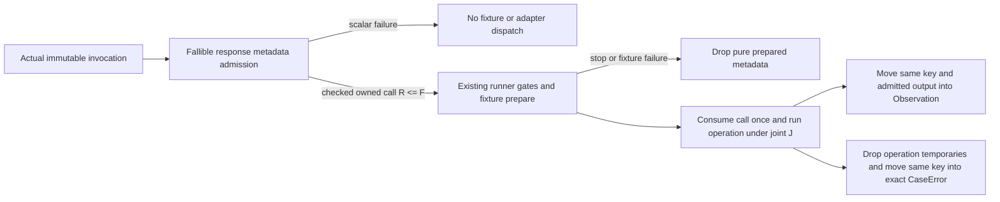

# TT02-RSP01 prepared response and opt-in dispatch proposal r2

**PROPOSED / ROOT CHOICES SELECTED / PENDING INDEPENDENT REVIEW / NOT_RATIFIED / NOT_IMPLEMENTED / NOT_RUN.** Root selected strong actual response admission, prepared-only BP03 with no legacy ConformanceAdapter implementation, and minimal typed scalar preparation failure plus nonterminal partial-v1 evidence. The stable maintenance identity is **TT02-RSP01**, scoped within accepted TT02 like its prior borrowing maintenance: it adds no product task and does not inflate or renumber the 86-task inventory. Prior TT02 acceptance remains historical evidence for its accepted scope, not acceptance of this new maintenance. A separately persisted outer dispatch receipt is explicitly deferred. Root will adopt canonical design/ledger changes only after independent critical review, then bind any implementation packet. BP03's response-F final gate stays unresolved.

R1 is preserved unchanged with index SHA256 `d1554839bab53555c3074d12c94ac8bf68556d979b9b49ef32c297d085c18c59`. This r2 freezes the selected route boundary, actual hook borrowing, chronology and exact amendment map. No source, canonical plan, job or acceptance record is changed.

The goal is an owned current-key success or exact refusal whose admitted response storage actually fits F, without retrying a new key copy after capacity refusal. The hard constraint is that the first actual-key metadata admission itself can fail. That must be an allocation-free scalar **no-dispatch** outcome outside the old total ConformanceAdapter result, not a fabricated executed CaseError. Keep existing TT02 callers and the old wire protocol intact through an explicit new opt-in route. The unaccepted BP03 draft is deliberately migrated to prepared-only use so identical legacy trait use cannot accidentally imply strict F. Keep process-wide OOM, subject()/report/history, and separate retirement allocation boundaries clear.

`input-index.json` pins individually stable current source copies. File abbreviations below refer to those private `snapshot/.worktrees/bp03-host-20261022-r1/crates/scopebase-testkit/` copies. The prior focused finding is pinned in this proposal's inputs. No compiler was invoked and signature sketches are not compile evidence.

## Source constraints that drive the design

| Source | Constraint |
|---|---|
| src/adapter.rs:4–11 | Old execute takes a borrowed CaseInvocation and returns owned Observation/CaseError; no outer no-dispatch failure exists. subject and retire are distinct hooks. |
| src/ids.rs:34–67, 102–148 | Private String IDs and recursively owned keys have infallible parse/Clone paths; no existing public bounded fallible owned-copy entry. |
| src/artifact.rs:1728–1733, 2102–2119 | Record new moves values and validates lengths/counts; it is not recursive capacity admission. |
| src/observation.rs:64–67; src/artifact.rs:1516–1520 | New Observation/CaseError validation calls unique; a general BTreeSet-based validator must not be silently counted as an allocation-free finish. |
| src/runner.rs:1034–1083 | Runner metadata hooks and invocation construction already clone caller/contract metadata and retain serialized payload charges. Those are outside the proposed bounded adapter execution region. |
| src/runner.rs:1199–1235 | Fixture prepare currently precedes adapter execute. Adapter participation is registered immediately before execute; the new response admission must occur before fixture prepare and before either participant is registered for this invocation. |
| src/runner.rs:1268, 1431–1439 | FixtureAccess drops before cleanup. Preserve this accepted borrow/ownership repair. |
| src/result.rs:811–901, 1605–1637 | A full v1 receipt cannot invent PriorStop/StageNotReached for a new response preparation failure. A permitted-before/unentered call is rejected. |
| src/result.rs:1005–1064; 1359–1373; 354–373 | V1 major/kind are strict. Nonterminal receipts and missing schedule members contribute Incomplete; independent Invalid/Failed evidence retains precedence. |
| src/result.rs:1048–1051, 1382–1476 | Cleanup slots are a fixed prefix with owner/scope/participation and budget validation. A new preparation failure must not bypass cleanup or drop pending custody. |
| src/bpf/adapter.rs:23–38, 80–88 | B/F are numerical admission only; current response creation still clones key/labels and allocates diagnostics. subject()/retire use ordinary metadata copies. |
| BP03 populations src/main.rs:8 | The actual delivered reference consumer uses BpfHostAdapter, VectorFixtureSession, linked BPF APIs, run_profile and report reimport; this is the primary integration route to migrate. |

## Recommendation and alternatives

**Selected for independent review: A, additive prepared-call trait plus opt-in runner, with a narrow private one-step response context and prepared-only BpfHostAdapter.** Existing TT02 ConformanceAdapter/run_profile callers stay source-compatible. BpfHostAdapter implements only ResponsePreparedAdapter, not ConformanceAdapter; it has no inherent borrowed total execute convenience path, blanket legacy implementation or implicit adapter conversion. Its sole strict-F routes are direct prepare_response followed by consuming BpfPreparedCall::execute, and run_profile_prepared. A successfully prepared call borrows the exact adapter and exact invocation, owns measured response storage, and consumes itself to execute. The existing runner remains the single owner of scheduling, fixture/truth separation, qualification and cleanup. Private route wrappers share that engine; no second verdict engine or allocator framework is introduced.

| Alternative | WHAT / WHY | Cost / limit |
|---|---|---|
| A — additive prepared call and run_profile_prepared | Explicit response-admission hook before fixture effects, scalar failure, self-consuming bound call; BP03 implements only the new trait | Two small opt-in traits, new runner entry/error, private route abstraction, narrow copy/finish internals and real client migration. Root selected, pending independent review. |
| B — BP03 direct fallible try_execute only | An inherent BPF adapter API returns outer scalar preparation failure and inner Observation/CaseError | Small direct API, but unchanged run_profile cannot consume the new failure case. Satisfies a direct-use increment only; does not deliver the requested runner/BP03 receipt route without another explicit adapter/runner change. |
| C — replace key/response representation with inline/shared storage | Make current-key copies allocation-free via an admitted representation, including its failure boundary | Wider changes to ID/key getters, Clone/serde/capacity semantics and retention of shared backing; String-returning public record getters complicate compatibility. Arc/Box alone does not bound admission or cover diagnostics/completion storage. No evidence this wider change is needed. |

The rejected repair is a capacity getter/check followed by another infallible error()/key clone. Moving an already fitting key is useful; moving an oversized key is still oversized. A subject-only constructor cannot prebuild future run/case/cell/attempt/operation identities. Prebuilding a finite whole run would add a different storage/admission policy and does not solve unknown direct calls. This proposal chooses per-actual-invocation admission.

## Proposed additive public boundary

Names below are proposed for review; they identify the exact intended roles. Public source signatures of ConformanceAdapter, run_profile, RunContract, Observation, CaseError, IDs and v1 receipts remain unchanged.

```rust
pub trait PreparedExecution {
    fn execute(self, fixture: &FixtureAccess<'_>)
        -> Result<Observation, CaseError>;
}

pub trait ResponsePreparedAdapter {
    fn subject(&self) -> SubjectBinding;

    type Prepared<'a>: PreparedExecution
    where Self: 'a;

    fn prepare_response<'a>(
        &'a mut self,
        invocation: &'a CaseInvocation,
    ) -> Result<Self::Prepared<'a>, ResponsePreparationFailure>;

    fn retire(&mut self, request: &RetireRequest) -> RetirementReport;
}

pub fn run_profile_prepared<A: ResponsePreparedAdapter>(
    plan: &ProfilePlan,
    adapter: &mut A,
    fixtures: &mut dyn FixtureSession,
    oracle: &dyn CaseOracle,
) -> Result<RunReport, PreparedRunError>;
```

The generic runner is intentionally separate and opt-in; the GAT prepared-call trait need not be object safe. Its subject/retire hooks keep the exact existing signatures but it does not extend ConformanceAdapter. Old dyn ConformanceAdapter callers still use run_profile. Strict BpfHostAdapter cannot be passed to that old runner: this is a deliberate compile-fail control. No LegacyBpfHostAdapter wrapper is selected or delivered by TT02-RSP01. Such a wrapper would require a separately named and explicitly unqualified compatibility contract if ever needed. BP03 has not been accepted/published, so preserving its unfinished draft trait implementation is not a compatibility requirement. No unstable trait upcasting, async runtime, public allocator hooks, generic budget service or public blanket conversion is introduced.

`PreparedExecution::execute(self, ...)` consumes the call. For BP03, public opaque `BpfPreparedCall<'a>` owns private response context and holds both `&'a mut BpfHostAdapter` and `&'a CaseInvocation`. It has no public fields, Clone, Copy, Default, serde constructor or deserializer. This prevents use with another adapter/invocation or a second execution: callers cannot substitute a later key between admission and execution. Dropping a ready call before execution releases pure metadata only and creates no adapter participation/effect.

`ResponsePreparationFailure` is Copy and contains only bounded scalar fields: `kind` (Allocation, CapacityExceeded, Overflow, InvalidInvocation), `component` (RunId, CaseId, CellId, Schema, Step, Stage, Method, Diagnostic, CompletionStorage, Total), and optional requested/observed byte demands. It owns no String, key, source error, Vec, Box or formatted diagnostic. Allocation failure never formats TryReserveError. InvalidInvocation is a preparation/protocol failure, not an executed BP03 refusal. Exact logical binding/dialect refusals for a valid invocation are prepared as ready outcomes and still return the existing CaseError shape when dispatched.

`PreparedRunError` distinguishes `Harness(HarnessError)` from `ResponsePreparation { schedule_index: usize, failure: ResponsePreparationFailure, followup_harness_error: Option<HarnessError>, partial_report: Option<RunReport> }`. schedule_index is exactly the zero-based RunContract.schedule().enumerate() index and must be less than schedule length; it is not a formatted or one-based case ordinal. The direct preparation failure itself is allocation-free. Building a runner partial report, diagnostic presentation, report serialization or external logging remains under the existing TT02 allocation/OOM boundary, outside F. Nothing promises a full keyed report when the runner itself cannot allocate. Typed getters expose the scalar cause/position, follow-up error and a single partial report without formatting or constructing a CaseError.

The **dual-error policy is explicit**: once response preparation fails, retain that variant and original scalar cause/index even if cleanup, retention, elapsed-time accounting or reconstruct subsequently fails. Preserve the engine's existing first HarnessError as followup_harness_error; do not replace it with a friendly preparation diagnostic or clear Invalid/uncertainty/custody. Move any existing HarnessError.partial report exactly once into the outer partial_report field and clear the nested partial field, so no report is cloned or retained twice. Successful preparation runs still return ordinary Harness(error) for unrelated engine failure. If the actual partial wire contains malformed cleanup or another protocol contradiction, reconstruction/serialization/reimport may return Err; preserve that error and the existing raw Invalid partial with its actual cleanup records rather than asserting it is an importable Incomplete report. Existing first-error policy applies among multiple later HarnessErrors; their raw cleanup/error/custody records remain in the one retained partial where available. A scalar preparation failure is never required to own a new key or allocate a follow-up diagnostic.

A context merely supplies owned metadata; it confers no native authority or verdict privilege. Only implementations whose own contract/tests meet the prepared bound may advertise it. Merely implementing the new trait does not certify an arbitrary third-party adapter's allocations.

## Narrow owned context and finish rules

Add only private response/copy internals needed by the one-step, empty-effects BP03 dialect. A future multi-step/effectful adapter must have its own separately designed contract; do not generalize this increment into a universal response builder.

1. `prepare_response` first compares invocation.limits with stored RunLimits using scalar equality. On mismatch it reads no script/input and prepares a fixed binding error using the stored ceiling. Validate the typed current key using exactly the accepted TT02 constructor/bounds invariants without allocating; add no new character grammar, normalization or stricter cell-name rule. For equality, perform the existing closed dialect preflight before copying schema/step metadata. Invalid dialect prepares the existing UnsupportedSchema response. No fixture byte, public BPF operation, source error, native effect or expected evidence is available during preparation.
2. Copy the **actual** run/case/cell key once using fallible owned-copy internals inside the module owning private ID Strings. Public parsers/Clone/grammar remain unchanged. Reserve a minimum requested charge before each allocation; after allocation measure actual String/Vec capacity, update the checked ledger and reject/drop partial context before returning Ready if it exceeds the admitted response budget. Never guess capacity from length or retain caller spare capacity uncharged.
3. A valid operation context owns the key, one schema label, one step label, pre-reserved completion Vec storage for one element, fixed method and all possible stage-label storage, and at least 128 usable diagnostic bytes. It may use a measured fixed label pool for binding/preflight/input plus all current BP01 stages. All simultaneous unused alternatives count. Do not allocate a second key for an emergency error. The step label moves into completion on success or into attempted-step on error; it need not be duplicated.
4. Prepare all needed fixed labels/diagnostic/completion backing before returning Ready. BP03's fixed/scalar diagnostics are generated into fixed stack scratch or admitted diagnostic capacity. A decimal usize demand has bounded digits; there is no format! allocation, untrusted text/source formatting, truncation or capacity-growing push on the finish path.
5. Context admission includes its inline footprint (once) and all recursively owned heap capacities. Include the maximum resulting response inline footprint if larger than the context's inline footprint. B is the moved adapter/subject's actual footprint; prepared context is not stored permanently in B. Require context charge R<=F and checked B+F+J<=RunLimits.retained_bytes. No operation-owned payload exists until successful preparation. R includes simultaneous normal/error alternatives, so no second fallback reserve is hidden.
6. After Ready, every operation failure drops operation temporaries and finishes an exact CaseError by **moving the same admitted key and owned metadata**. No fresh clone/copy/allocation of response metadata, retry, replenishment, or emergency key is permitted. A pure byte/scalar invariant check is allowed. Success moves the same key/schema/step storage plus an already admitted output Vec once.
7. A private allocation-free finisher must enforce the exact semantic invariants previously supplied by public record constructors. Use prevalidated private construction for this narrow shape rather than calling the allocating generic unique/BTreeSet validator on success. The unchanged runner still revalidates the public outcome after handoff under its existing allocation contract. Even empty EffectBatch/RefusalEvidence construction on the bounded finish path must use admitted or allocation-free private construction rather than relying on a generic validator to happen not to allocate. No unchecked public constructor or deserialization bypass is introduced.
8. Finish only accepts a private admitted-output value whose byte length and actual capacity have already passed both RunLimits and joint J admission. Error categories/stages/step shape come from closed BP03 paths; a fixed validated error template remains usable even if an operation allocation fails. Invalid internal use is a product defect, not a permitted panic-based memory bound. No untrusted path is allowed to depend on .expect for response capacity.
9. At publication the actual returned header Q<=R<=F. Its output buffer is counted once with J before handoff; moving it does not allocate or create a second buffer. Drop unused prepared alternatives before returning. Caller report retention begins after handoff and remains outside this per-call execution claim.

This is an admitted/retained capacity guarantee. Preparation can temporarily receive more capacity than requested before it detects and drops excess. It is not an allocator/RSS, allocator-internal rounding, hard transient allocation, elapsed-time, unwind or process-wide OOM guarantee. Fixed stack scratch and original borrowed invocation storage remain excluded. The important strong claim is **actual admitted response capacity and an allocation-free response finish after successful preparation**, not an imaginary bound before the allocator returns.



## Runner compatibility and chronology

Use a small crate-private DispatchRoute abstraction in the existing runner, with LegacyRoute holding `&mut dyn ConformanceAdapter` and PreparedRoute<A> holding `&mut A` for A:ResponsePreparedAdapter. Its only roles are subject(), prepare_call(actual invocation), consuming call execution, and retire(). LegacyCall holds the old adapter/invocation borrows and invokes old execute; its preparation performs no metadata allocation or new hook/poll. PreparedRoute returns the opaque A::Prepared call. A shared generic run_engine and Engine::phase use these private route hooks directly; neither needs a public ConformanceAdapter view of strict BP03. No trait-object upcast or inspection of associated-type fields is required. Both routes feed the same existing outcome validation, mirrors, collect/oracle, cancellation/deadline and cleanup implementation. Do not fork run_engine or add a second qualification path.

For an executable, permitted invocation on the prepared route:

1. Under the existing executable && !e.stopped condition at runner:1199, construct the current CaseInvocation using existing admitted contract machinery (1200). This is runner metadata outside F.
2. Admit the pure response call immediately after that construction and **before the existing Prepare.before sample at 1201–1202**. No extra checkpoint, stage or probe poll is added. Preparation cannot enter after an already latched stop. It may run before a cancellation/deadline not yet observed by the next existing sample; it has pure finite metadata work and promises no hard elapsed interruption. The unchanged sample freshly gates fixture entry and includes all preparation duration in the normal execution allowance. On a sample stop, drop the admitted call before any fixture effect and use the actual existing cancellation/deadline evidence. On scalar preparation failure, no response call exists and the partial-report path below applies.
3. fixtures.prepare still returns the accepted borrowed FixtureAccess; that borrow remains live through execution. Register Fixture only at actual fixture entry. On fixture failure or later gate stop, drop the prepared call before cleanup; never fabricate adapter participation.
4. Once the execute gate and existing observation allowance admit entry, register Adapter and consume the call. Its result is the ordinary Observation/CaseError; preserve current keys, schema/progress, cause, effects and actual raw library errno. Retain/validate/capture result and collect/judge exactly as the existing engine does.
5. Drop FixtureAccess and any unconsumed prepared call before case/run retirement. Keep the owned cancellation probe alive through the fixture borrow exactly as accepted TT02 maintenance requires.

The private wrapper calls subject()/retire() only after an admitted call has been consumed or dropped; it never regains a mutable adapter while opaque A::Prepared still borrows it. Runner gate/probe calls while Ready is live borrow only Engine and its independently owned cancellation probe. They remain runner work outside adapter execute F/J, not allocation-free whole-run work. The bounded finish never calls these gates. There is no unsafe lifetime widening, trait upcast, callback array or delegated metadata method on the opaque call. The following source-based hook/branch schedule closes the borrowing design; MSRV compile/borrow checks remain execution evidence, not a substitute for that design.

Preparation failure is **not** a BPF operation error and does not consume BPF work or call fixture prepare/collect, adapter execute, oracle evaluate, or current-case retirement hooks with fake participation. It does consume ordinary elapsed execution allowance and may allocate metadata during the admitted preparation phase. Stop new normal work, retain the scalar schedule position, and run all existing fixed cleanup phases for previously entered participants, including run cleanup. Current/unentered owners receive ordinary UncalledNoParticipation slots; do not manufacture a clean ledger or discard earlier unresolved ownership.


### Exact opaque-call borrowing schedule

| Existing hook or action | Source | Receiver while Ready lives / release rule |
|---|---|---|
| Entry subject metadata | runner:1143 | Runs before the case loop and before any Ready exists. |
| Existing Prepare.before sample | runner:1201–1202; sample:719–745 | Engine clock/probe/stopping latch only, not adapter. It now follows pure response preparation. |
| fixtures.prepare(&i) | runner:1208 | Mutably borrows the separate FixtureSession, while Ready borrows only adapter and immutable i. FixtureAccess owns its entry arrays/borrows stable providers per accepted TT02 maintenance. |
| capture_batch, prepare.after and execute.before | runner:1211–1219 | Engine/ledger/clock/owned probe and returned fixture effect batch only; no adapter hook. Allocating runner mirrors remain outside F/J. |
| Next observation allowance and stop/error bookkeeping | runner:1221–1228 | Engine fields/scalars only; an early refusal branch explicitly drops Ready and FixtureAccess before cleanup. |
| Adapter operation | replaces only runner:1232 | call.execute(self,&access) consumes the opaque call through its public trait bound. It owns the exact adapter reference and actual invocation internally. Runner need not inspect fields. |
| Result retain/mirror/checkpoints/validation | runner:1236–1263 | Call has returned and been consumed; adapter borrow is released. Engine/rule/outcome only; legacy validation allocation stays outside the bounded finish. |
| Access drop, collect and oracle | runner:1268,1309,1368 | FixtureAccess is dropped at 1268; Ready was consumed/dropped. No adapter hook is needed by collect/oracle. |
| Case/run retirement | runner:1431,1439; phase:903–908 | Runs outside the per-invocation lexical call scope. phase invokes route.retire(&request) directly after all Ready/FixtureAccess borrows end. |
| Final subject metadata | runner:1471 | After all case/run phases; no Ready exists. |

The per-invocation code has one explicit lexical scope ending before Engine::phase. Every path is closed:

- Not executable or prior latch: no preparation call is created.
- Scalar preparation failure: Err contains no Ready or adapter borrow; retain the scalar, stop normal work and finish cleanup.
- Ready then Prepare.before stop: drop Ready before leaving the scope; no fixture entry/participation.
- Fixture prepare error: drop Ready before processing that failure and before cleanup; Fixture participation remains truthful, Adapter never entered.
- Fixture access returned, but after-prepare/execute gate or observation allowance stops: explicitly drop Ready and access; no Adapter participation is inserted.
- Execute permitted: insert Adapter participation, move Ready into execute exactly once, and process its ordinary returned outcome. The ready self value no longer exists.
- Later collect/judge/clock/protocol failure: Ready was already consumed/dropped; existing cleanup paths run unchanged.

The route never calls subject, retire, or a second prepare while an opaque prepared call exists. Dropping an opaque prepared call needs only std::mem::drop; BP03's call destructor releases pure metadata and has no native cleanup/effect. A compile test must demonstrate these exact branches, but no unknown hook or additional trait capability is left to be invented by the implementer.

## V1 receipt preservation and failure evidence

Successful prepared runs produce unchanged schema1 `tt02-run-report` observations and outcomes. Their report origin/qualification/reimport rules remain exactly the current engine's. The consumer's measured sources, selected route and direct capacity/copy-entry controls establish the prepared path; a serialized successful report alone cannot certify allocator behavior or live execution.

A preparation failure must **not** be represented as a completed full v1 report with invented PriorStop, StageNotReached, deadline/cancellation, fixture error, adapter CaseError or capability refusal. The current importer rejects such false omission premises for good reason.

The minimum compatible failure route returns `PreparedRunError::ResponsePreparation` with its scalar cause/index, any subsequent first HarnessError, and one conservative **nonterminal partial v1 report** if normal TT02 bookkeeping remains available:

- Preserve actual earlier rows/outcomes/checkpoints and all actual cleanup records/custody.
- Keep the already created schedule-prefix row through the failure position as ExecutionState::NotRun with case terminal=None, no entered stages, and no outcome/fixture failure/expected evidence/verdict/effect batches. Reuse that runner-owned row; the scalar error itself must not clone or own a new key. Mark its normal-work checkpoint tail NotRecorded; do not invent a permitted before gate followed by an unentered full-report call.
- Perform fixed cleanup slots through all case/run phases in their original order; their evidence remains separate from normal-work tail truncation.
- Set run_terminal=None. Final normal-work metadata/completion checkpoints are NotRecorded, and no sampled normal-work checkpoint may follow the first NotRecorded tail. Do not relabel an actual failure as a cancellation just to obtain a valid full receipt.
- For an otherwise clean run, reconstruct/import that partial report as Incomplete with no capability/functional pass for the unexecuted case. Preserve actual earlier Failed/Invalid evidence and the existing Invalid > Failed > Incomplete qualification precedence (result:354–373); never force a weaker result over independent earlier evidence. The precise preparation cause/position live in the scalar API error, not as invented v1 authority. A partial report does not prove why execution stopped.

This reuses the existing partial-report model and must be demonstrated against unchanged strict replay. Do not loosen Gates::pair or claim full-record evidence to fit this new case. Root selected this minimal typed-API/partial-v1 route. A separately versioned persisted outer dispatch receipt is explicitly deferred; it is not needed to exit TT02-RSP01's selected scope. The old importer must continue rejecting unknown fields/majors. Do not add scalar fields to schema1 or treat free-form case.reason as a causal oracle. Runner report/cleanup allocation remains separate from F: scalar failure requires no new key; optional partial-report construction/presentation retains existing TT02 process-wide allocation/OOM limitations.

## Explicit allocation boundaries

| Region | Included / excluded promise |
|---|---|
| Adapter construction | Actual recursive retained subject B, moved once; existing subject validation/admission error machinery remains TT02 allocation/OOM behavior. No future key prepared here. |
| Per-call response preparation | All owned context capacities counted and checked before Ready. Failure scalar allocates nothing; partial prepared buffers drop. Successful context actual charge <=F. Post-allocation overgrant is detected, not magically prevented. |
| Prepared execute | Stored actual B, admitted actual response R<=F, all actual operation-owned J, required joint composition/work limits and allocation-free response metadata finish. No new metadata copy. |
| subject() | Existing SubjectBinding clone belongs to runner/caller; outside prepared execute F/J. It supplies no native authority or memory certification. |
| retire() | Existing request identity/pending/uncertainty and TT02 remaining-budget/CalledOverBudget/Incomplete rules. Unexpected pending snapshots can be variable-size; no constant F guarantee is claimed for retire. Preserve actual pending custody and cleanup result. |
| Runner/fixture/oracle/report/history | Existing allocation/OOM and serialized retention accounting; checkpoint/probe gating, immutable invocation/contract/fixture input ownership, post-handoff outcome validation, report clones/serialization/reimport and effect mirrors remain outside the adapter execute ceiling. New admission does not rewrite that accounting into actual-capacity accounting. |

Strict BpfHostAdapter implements **no ConformanceAdapter and no borrowed total execute convenience method**. Its strong actual-F promise applies only to consuming an admitted BpfPreparedCall, directly or through run_profile_prepared. Existing TT02 adapters and dyn run_profile callers retain their legacy contracts. This deliberate BP03 route/precondition amendment is **not** changing F into a logical-only allowance. Constructor new remains the numerical B+F reservation/minima admission; only actual-key preparation owns/admit-checks response storage. B and every operation J capacity/work/composition rule remain unchanged. A request to preserve total F-bounded owned current-key CaseError on the old borrowed signature even when the first key cannot be admitted would require a wider representation/error-channel decision, and is not this selected route.

## Causal regression/control inventory

All entries are planned NOT_RUN. Local IDs PRP01–PRP13 are proposal-local and do not renumber H/UC/G requirements or allocate task IDs.

| ID | Required observation and known-bad control |
|---|---|
| PRP01 actual capacity oracle | Independently sum context/record inline size once plus actual ID/String/Vec element/nested capacities and all simultaneous alternatives; compare production charge. Short-byte/F+1 spare storage must fail admission. A length-only or omitted-vector-element mutant fails this exact assertion. |
| PRP02 repeated copy excess | Private owning-module seam creates real extra-capacity String/Vec storage at the actual copy boundary after valid bytes. Apply to every attempted copy, not first only. Expect scalar CapacityExceeded with exact observed charge, one finite attempt, no fixture/operation entries. Restored fitting allocation admits identical bytes. A retry/fresh-fallback-key mutant fails the entry/allocation counter. No global allocator failure injection or arbitrary OOM assumption; this seam remains distinct from the selected nonfaulting observer. |
| PRP03 fallible failure/overflow | Inject TryReserve failure and checked capacity composition overflow in each metadata component. Scalar kind/component/required/observed fields remain exact; no String/source formatting, output or partial context escapes. Restored twin succeeds. |
| PRP04 actual allocation observation after Ready | Use the isolated forwarding allocator observer below over the full actual Ready->handoff call, enclosing real finish. Zero-operation/binding/preflight/refusal paths require zero allocation entries; allocating paths require independently attributed operation/output entries and exact J. Mutants restoring generic Observation::new/unique, cloning key/Label before finish, or formatting fallback must fail the intended real allocation assertion, not a helper-entry marker or setup. Private owner-local failure/excess seams remain separate. |
| PRP05 linear identity and borrow | Distinct run/case/cell/attempt/operation invocations use distinct contexts. Compile-fail reuse, Clone/default/private construction, use with another invocation/adapter, executing after invocation drop, reborrow/retire while call owns adapter, and retaining dangling FixtureAccess. A one-spare/constructor-key cache fails second-invocation refusal identity. |
| PRP06 binding/dialect priority | Every stored/invocation RunLimits mismatch prepares exact binding CaseError without script/input scan; adequate name256 current-key response works with otherwise legal different invocation limits. Unsupported schema/op/feature/arity/parameters preserves no step/progress/errno/effects before input. Preparation-capacity failure remains outer scalar, never disguised as these logical errors. |
| PRP07 success/error finish semantics | Independent literal outputs and exact all-field response assertions for normal filter/profile/JSON success and each intended failure. Compare against TT02 public validation/reimport without using that validator to build expectations. Single-step completion uniqueness and UnsupportedSchema constraints remain enforced despite narrow private finish. |
| PRP08 joint live peak/handoff | Measured R plus two-record/prefix/output J and B fit the exact restored cap; minus-one refuses before publication. Include unused error alternatives, completion storage and diagnostic scratch ownership if heap-backed. Header Q<=R<=F and moved payload counted once. Omitting one live buffer/alternative, per-record reset or hidden diagnostic copy fails the semantic capacity assertion. |
| PRP09 preparation stop chronology | Stop/cancel before prep, during pure prep and after admission; no effectful hook enters after gate, admitted context drops before cleanup, elapsed preparation charged to normal allowance, probe acquired once/owned through fixture borrow. Old legacy route's checkpoint/poll semantics remain unchanged. |
| PRP10 cleanup after late preparation failure | Earlier invocation deliberately retains real test-owned pending/uncertainty entries; next prep fails. No current-case participation/effects fabricated; prior case/run cleanup and reconciliation retain exact owners/identities/budgets. Clearing pending or treating preparer as an executed owner fails custody assertion. |
| PRP11 receipt compatibility | Prepared success returns/reimports schema1 with existing qualified/model distinctions. An otherwise clean prep failure returns typed scalar plus nonterminal partial receipt reimported Incomplete. Separately authored negative receipts add false full terminal, fabricated PriorStop/StageNotReached, false Execute/outcome/effect mirror, later sample after NotRecorded, missing cleanup, wrong-owner or false-clean snapshots. API-level tests separately require the actual schedule index and exact scalar failure; v1 has no such scalar-cause field. Existing strict old receipts keep their original results. Scalar cause is not accepted as proof from v1 reason text. Earlier independently Failed/Invalid evidence must keep precedence over the otherwise Incomplete preparation stop. Inject a later cleanup/retention/reconstruct error: both scalar prep cause/position and actual first HarnessError/one raw partial/custody must remain available; malformed raw wire must still fail replay rather than being relabeled importable. |
| PRP12 old callers/API/traits | Original TT01 inventory/selection and TT02 run/receipt clients compile/run unchanged against source/archive under actual default/minimal compiler cells; preserve existing dyn ConformanceAdapter, FixtureSession owned-probe/FixtureAccess borrow contract and public ID/output/wire grammar. New prepared route compiles under MSRV1.88 and current pinned compiler. Strict BpfHostAdapter passed to old run_profile or used as dyn ConformanceAdapter must fail compilation for the intended missing implementation, preventing accidental legacy use. No public allocator/error source or deserialize bypass. |
| PRP13 real BP03 consumers | Change actual shipped bp03-populations source and exact root client mapping to call run_profile_prepared with real linked BpfHostAdapter/VectorFixtureSession/LiteralOracle. Preserve direct public BPF model/filter/profile/JSON calls and actual report reimport. Add direct prepared-call case exercising actual capacity/error path. Rebind consumer/oracle/control sources and final binary/library IDs to these changed bytes, and execute source/archive required feature cells. A separately built receipt helper or mocked response wrapper cannot stand in for this client. |

The preparation-copy seam must return an actual valid allocated buffer with measured spare capacity; injecting only a fake reported number would not exercise ownership. The repeated seam must remain active for fallback attempts. Independent controls name exact scalar/semantic assertions and zero-activity/allocation observations. Owner-helper counters alone cannot certify zero metadata allocation: direct derived Clone, format! and generic-validator/BTreeSet calls can bypass them. The required allocator observer below covers the actual consuming call, including before finish. Expected allocator-refusal capability stays denied/unknown; no live native support or hard RSS guarantee follows.

### Selected isolated allocator-observer exception

Root explicitly selected this **TT02-RSP01 successor exception** to the old BP03 plan's blanket no-global-allocator wording. Preserve private owner-local allocation-failure/excess seams for constructors and operations. In a dedicated isolated integration executable only, install a forwarding std::alloc observer solely to count actual alloc, alloc_zeroed and realloc entries on the measured test thread; count dealloc separately. No failure injection, host/product allocator replacement, production hook, RSS/foreign-allocator or general OOM claim follows. The normal library, other test executables and existing clients keep their allocator behavior. This is an explicit test-policy amendment, not a relabeling of the historical seam-only plan.

Register a separate Cargo integration test target `tt02_rsp01_alloc`, path `tests/tt02_rsp01_alloc.rs`, **harness=false**, required-features=["bpf-host"]. It is a single-purpose main executable, not a case added to the existing multithreaded harness. JSON coverage is additionally cfg-gated by the existing bpf-host-json feature; introduce no product observer feature. Its binary owns the forwarding allocator, links the actual delivered scopebase-testkit/BPF package identities, and invokes public actual prepared calls. Copy any support fixtures into already delivered tests/fixtures/ paths; verify source/archive inclusion and run the exact built executable.

Before arming, initialize allocation-free constant TLS state/counters and complete setup, context preparation, fixtures, expected literals and any direct-operation attribution measurement. Observer callbacks only update preinitialized fixed Cell/scalar state and forward the actual allocator call; no logging, allocation, lazy TLS initialization, formatting, locks or recursion-producing bookkeeping is allowed. Run each measured window on the known thread; disarm before assertions, formatting, result inspection or harness/helper logging. Drop/deallocation may occur during finish and is allowed, but is counted separately. Observer empty-window and intentional-allocation controls must first show zero and nonzero sensitivity with no setup contamination on each supported compiler. This design is not yet compiled or qualified under MSRV.

Arm **externally around the whole public consuming PreparedExecution::execute call**, so the actual finisher and any key/Label clone inserted just before it are inside the window. Do not arm only a new copy helper or only enter a marker in the mutant. Exact binding/unsupported/zero-work refusal routes have no legitimate operation allocation and must show zero alloc/alloc_zeroed/realloc entries. For a positive simple filter route, independently establish the single legitimate output-Vec reservation and its actual J charge; the full window has no other allocator entry. Restoring generic Observation::new on that one-step success must expose its real unique/BTreeSet allocation and fail.

For allocating profile/JSON routes, keep full-call observation armed and attribute legitimate operation allocations separately, using actual direct public BPF/ID calls with identical fixed admitted inputs/caps and the fixed adapter output/prefix allocation protocol. These attribution measurements are allocation evidence only, not semantic truth: independent literal outputs/error expectations and actual joint J capacity checks remain required. Never exempt an entire loosely labeled operation window or use the full adapter's own total as its expected count. Any unaccounted entry remains a failed control/qualification gap; a direct clone before finish, dynamic diagnostic formatting or generic validation cannot be waived as operation work. Record actual allocator-entry counts, capacity demands and direct/adapter package identity, and preserve NOT_SENSITIVE/NOT_RUN if independent attribution preconditions are not established. The implementation review must inspect this closed finish/copy call graph as well as the real observer results.

Required controls are (a) fresh current-key/Label clone after Ready but before finisher, (b) public generic Observation::new/unique restored on successful finish, (c) format! fallback on a refusal path, and restored twins for each. Each mutant must finish valid setup and fail the zero/unaccounted-allocation assertion at the intended measured path. No allocation-observer control may be claimed from source markers alone. All remain NOT_RUN in this proposal.


## Required BP03 and TT02-RSP01 adoption amendments

The following are required reviewed successor changes, not edits made by this proposal. Preserve frozen r2 artifacts and their earlier review; bind the adopted successor and exact hashes rather than rewriting the historical packet in place.

| Surface | Required WHAT / WHY |
|---|---|
| BP03 host.md:396–418 | Replace the drafted impl ConformanceAdapter for BpfHostAdapter with ResponsePreparedAdapter plus public opaque BpfPreparedCall/consuming PreparedExecution. State old run_profile rejects the strict adapter by type. Preserve three-argument new, checked profile bridges, optional features and host-only core. |
| BP03 host.md:552–567 | Replace the now-obsolete claim that no new public trait/fallible-copy boundary is added. Bind TT02-RSP01's additive prepared-only contract; no public allocator hook or universal response framework is added. |
| BP03 host.md:569–623 | Retain constructor subject/BPF/minimum/actual B/numerical B+F order. Separate actual-key preparation from constructor reservation. Fixed logical binding/dialect errors require successful metadata admission; first-key admission failure is scalar no-dispatch. Name/label/diagnostic actual storage stays in F after Ready. |
| BP03 host.md:625–685 | Preserve B, H, joint J, work and payload prepayment. Define actual response-context R<=F and consuming Q<=R. Include all simultaneous alternatives; replace fresh response clone/fallback assumptions with finite owned finish and narrow private copies. Existing four private capacity getters remain; their presence alone is not acceptance. |
| BP03 host.md:657–661,772–776 | State subject()/runner history/probe gates and retire() are separate TT02 allocation/budget boundaries. No fixed F claim covers variable pending-retirement snapshots. Preserve owner/identity/uncertainty and no fabricated cleanup authority. |
| BP03 verification plan:29–38,711–743 | Bind TT02-RSP01 as necessary maintenance, replace Task4's ConformanceAdapter/run_profile instructions with prepared trait/run_profile_prepared, and add causal metadata admission/zero-post-admission-allocation/legacy-compile-refusal checks. Existing T0 literal oracle, independent direct public BPF calls, effects and receipt reimport retain their meanings. |
| Observer target and delivery policy | Add explicit tt02_rsp01_alloc test target with harness=false/required-features=bpf-host, source/archive support inclusion and exact helper invocation. Update crate Cargo.toml, package-policy/metadata expected target declarations, tests/package-policy/bp03 target checks and a reviewed manifest-additions-testkit.toml successor plus finite asset index/hashes. Existing expected dependency/feature sets stay unchanged unless a real new edge is separately adopted. PRP12/13 must execute the actual isolated delivered binary, not merely compile a target declaration. |
| Canonical finite authoring assets | Update a reviewed successor for docs/superpowers/specs/bp03-host/adapter-cases.json, the asset README and finite-asset index/hashes. Existing binding/dialect/operation CaseError recipes keep stable IDs/results **after successful metadata admission**; add scalar first-key admission failure, actual-capacity, repeated-copy and true finish-allocation controls. Preserve immutable r2 corpus/index/review as historical input and bind new hashes in canonical docs/job packet; do not leave machine-readable limits-mismatch cases promising unconditional CaseError. |
| Shipped populations consumer and exact root mapping | Change tests/fixtures/bp03/clients/populations/src/main.rs and tests/package-policy/fixtures/clients/bp03-populations.rs byte-identically to the prepared runner. Add direct prepared-call coverage and scalar-failure/partial-v1 checks in the delivered package route. Rebind actual consumer/oracle/control files, package/library ID, features, final executable and artifacts; an old source receipt does not qualify changed bytes. |
| Adapter tests/UI and new TT02 user route | Remove draft direct old-trait execute use from BP03 tests; use actual preparation and consuming call. Add explicit compile failures for old runner/dyn legacy trait use with BpfHostAdapter. Deliver independent TT02-RSP01 preparation/finish controls and an installed route, not only dependency tests. Preserve original TT01/TT02 legacy clients unchanged. |
| Root spec/plan/TODO/traceability/navigation/jobs | Add TT02-RSP01 as scoped maintenance under accepted TT02 with dependencies/exit, not a new product task; preserve 120/86/179 baseline inventory unless a separately justified source-obligation change is adopted. Accepted TT02 historical scope remains accepted. Mark BP03 response-F gate dependent on this maintenance; bind exact successor APIs and final resources before fixes. |

No BP03 core/filter/codec/profile truth, B/J capacity guard, source admission, native capability, outer receipt protocol or complete runtime/conformance profile is accepted by these documentation changes.

## Files, ownership, dependencies and acceptance

This is proposal scope, not a bound execution packet. One writer owns TT02-RSP01 response/dispatch core: new `src/prepared.rs` (or equivalent narrow module), `src/ids.rs` private copy internals, `src/observation.rs` narrow private finish, `src/runner.rs` shared route/error path, and `src/lib.rs` additive exports. Keep artifact macro/public record representation and result replay unchanged unless independent review proves a concrete required correction. A separate BP03 integration writer may own `src/bpf/adapter.rs` and BP03 fixture/client/test files **after** the core API and accounting contract are frozen. Serialize changes touching ids/lib/runner, manifests, root policy, source bindings or shared helpers; no simultaneous writers of those files.

The TT02-RSP01 owner also owns new independent unit/integration/UI tests and preserves current `src/runner/tests.rs`, `tests/{binding,fixture_access,harness_controls,verdict}.rs`, all harness fixtures and original TT01/TT02 installed clients. The BP03 owner preserves all existing B/J/codec/filter/profile controls, migrates actual populations/direct prepared consumers, and updates their exact source/archive bindings. Root alone adopts the canonical design/TODO/traceability/navigation/claim changes and binds actual base, dependencies, compiler/cache/lock/features, build wrapper/resources and independent reviews. Rebase other prepared packets only against a named accepted TT02 successor; source admission or an old green receipt never certifies changed public/core bytes.

Dependencies are accepted TT02 plus its borrow maintenance, the frozen BP03 F/B/J/refusal contracts as explicitly amended for the prepared route, and the actual BP03 host implementation as its first reference consumer. CP05/LX08/TT03/native fixtures are not implementation prerequisites. Their existing future joint input indexes consuming TT02 must not silently retain stale API hashes after the core changes. No live donor refresh or new native/privileged build is required to design/implement this host-only mechanism.

Qualification must include meaningful PRP controls and restored twins; exact supported source/archive default/minimal core tests; affected harness/borrow/probe/cleanup/receipt/API compile checks; all four original installed TT01/TT02 client routes in their current campaign cells; and actual BP03 consumer/core/JSON feature cells with one linked BPF package identity. Preserve the currently admitted 20 testkit cells/80 old client runs and affected BP03 12 activated cells/24 new runs as historical denominators until the controller explicitly updates the later campaign for the new task; do not infer new passes here or rerun unrelated native BP02 qualification merely because a host response API changed. Use the controller-bound absolute build lease and fresh private outputs in the later packet.

Before acceptance, root needs independent review of this exact proposal/contract choice, a concrete normative spec and implementation plan, TT02-RSP01 maintenance dependency/exit ledger entries, a bound implementation packet, observed changed-byte RED/GREEN and affected delivery checks, final source R1 and source/archive consumer review. BP03's response-F final gate stays unresolved until the selected prepared route and real consumer are accepted. Core/helper work may continue disjoint, but acceptance cannot be inferred from adding capacity getters or this proposal.

## Self-review and explicit decisions

The recommendation preserves a strong actual admitted response capacity bound, but exposes first-key admission failure through a new scalar no-dispatch boundary. It does not promise total legacy-keyed fallback under that failure. Existing subject/retire/runner bookkeeping scopes are explicitly separate. The proposed context binds current invocation and adapter by lifetime, allocates no finish metadata, and has one finite ownership route to success/error. Old wire protocol and callers are preserved; new failure cause is not smuggled into a full v1 receipt.

Root's selected choices are closed in this r2: A's additive GAT prepared-call route; strict BpfHostAdapter implements only the new trait; exact private wrapper hook/branch chronology above; first-key preparation failure is scalar/no-dispatch; conservative nonterminal partial-v1 evidence with existing qualification precedence and cleanup; persisted outer dispatch receipt deferred; maintenance identity TT02-RSP01 without product-task count inflation. No response-context field inspection, delegated metadata hook on Ready, trait upcast, extra checkpoint/probe poll or duplicate engine is needed. The design and signature sketches remain subject to independent critical review and canonical adoption before any implementation packet. Source fixes are not authorized by this private proposal. Strong actual F/B/J are retained; logical-only F was not selected.
